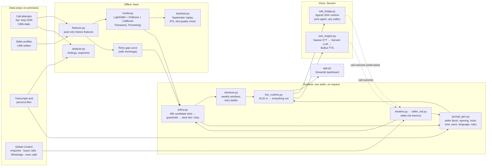
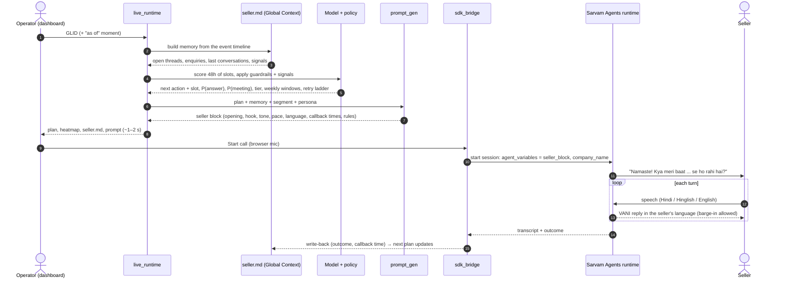
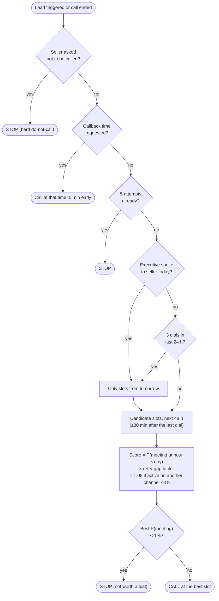
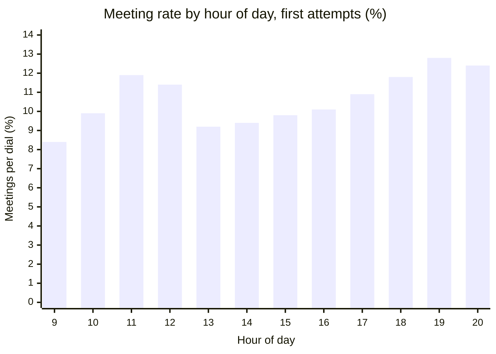
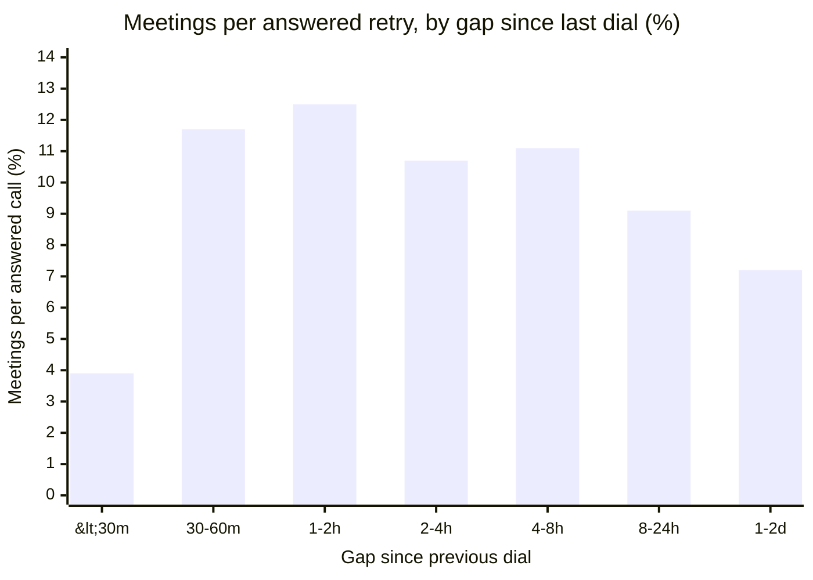
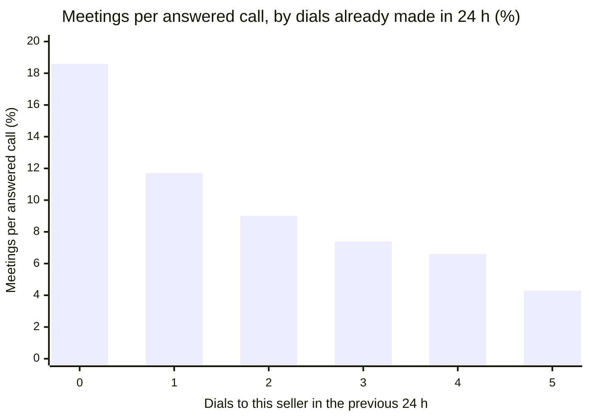
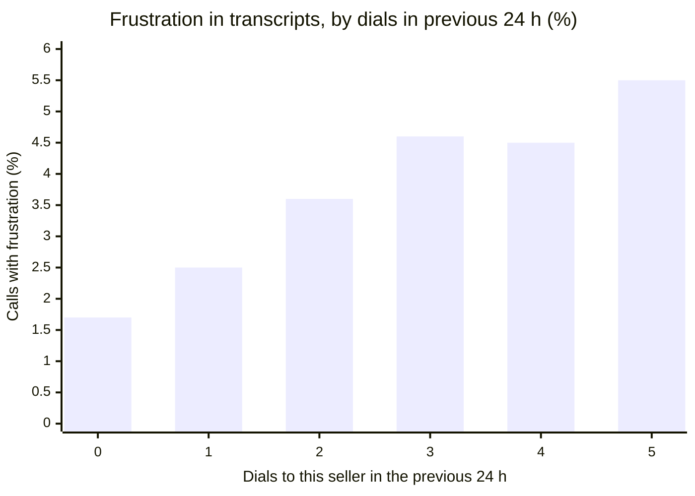
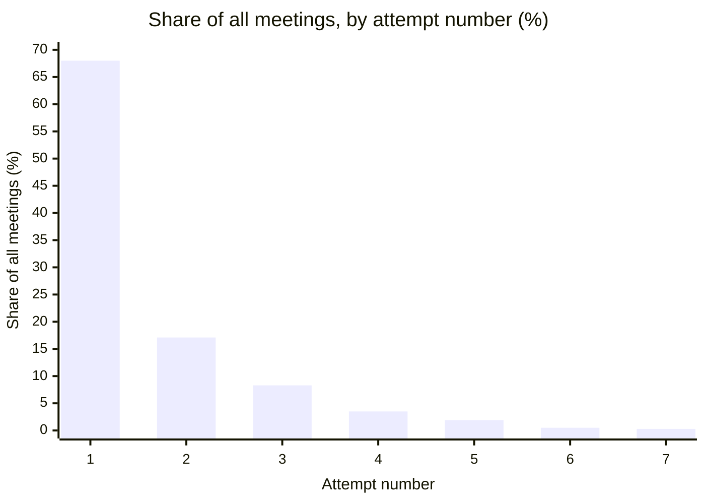
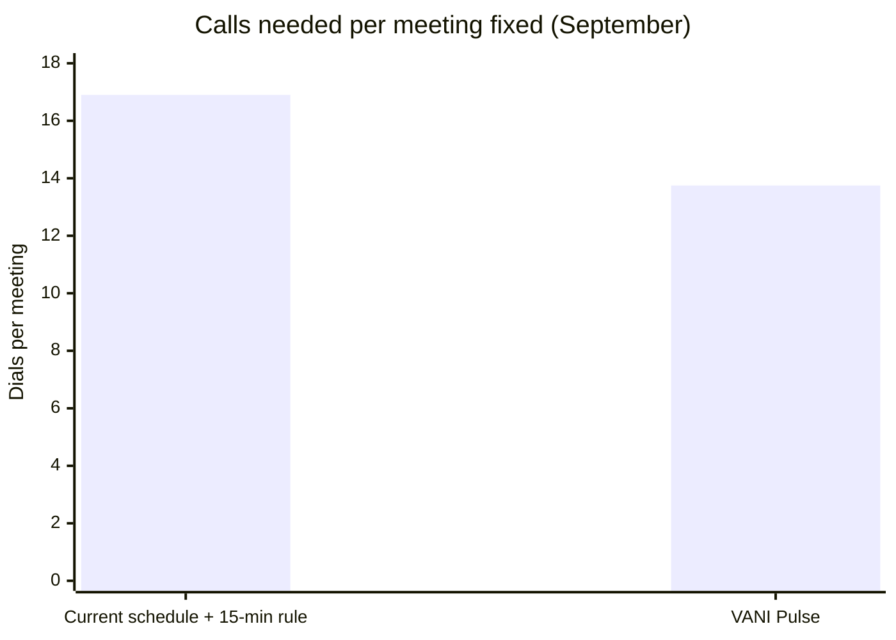
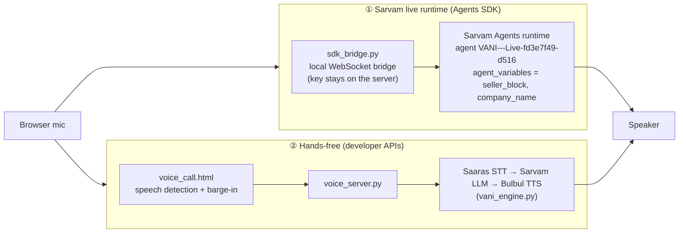

# VANI Pulse

*Best Time to Call for VANI: the right time, the right words, every seller.*

**IndiaMART Voice AI Hackathon 2.0 · Problem 3: Best Time to Call** · Team **Gian.AI**: Vedant Kothawade, Meet Jain
**Sarvam agent:** `VANI---Live-fd3e7f49-d516` ("VANI - Live runtime test (any GLID)")

VANI is IndiaMART's voice bot that calls sellers to fix a meeting with a sales executive. Today it calls on a fixed schedule and redials unanswered sellers after exactly **15 minutes**, which costs about **17 dials per meeting** and irritates sellers. **VANI Pulse** replaces that with a per-seller plan and a per-seller prompt:

| VANI Pulse decides | How |
|---|---|
| **When** to call | An ML ensemble scores every hour × day for this seller; the best allowed slot wins |
| **When to retry, and when to stop** | A learned retry-gap curve plus guardrails (no redial within 30 min, ≤3 dials a day, ≤5 per lead, stop below 1% meeting chance, honour callbacks) |
| **What to say, and how** | A seller-specific prompt block: opening by last-call outcome, hook with the seller's real enquiry numbers, tone and pace by segment, two callback times, language switching, live adaptation |
| **What VANI already knows** | `seller.md`: the seller's memory across channels (Problem 2, Global Context), refreshed after every call |

**Headline (held-out September, 124,779 real dials):** 17.5% fewer dials · calls per meeting 16.9 → 13.75 · meetings +1.3% (est.) · +6.6% meetings at equal dials · verdict on the 15-minute rule: **CHANGE**.

---

## Contents

1. [Architecture](#architecture)
2. [What happens for one seller (runtime flow)](#what-happens-for-one-seller-runtime-flow)
3. [The retry policy as a decision flow](#the-retry-policy-as-a-decision-flow)
4. [What the data says (charts)](#what-the-data-says-charts)
5. [Results on held-out September](#results-on-held-out-september-2026-trained-on-apraug)
6. [Problem 3 brief: how each requirement is met](#problem-3-brief-how-each-requirement-is-met)
7. [Global Context: memory across channels](#global-context-memory-across-channels-problem-2-integrated)
8. [Scheduler spec alignment](#scheduler-spec-alignment-allocator-tiers-production-prompt)
9. [Recommendation on the 15-minute rule](#recommendation-on-the-15-minute-rule)
10. [Key findings](#key-findings-aprsep-2026-530k-attempts-149k-sellers)
11. [Voice: VANI on Sarvam](#voice-vani-on-sarvam)
12. [Demo dashboard](#demo-dashboard)
13. [Project structure](#project-structure)
14. [Run it](#run-it)
15. [Outputs](#outputs)
16. [Data privacy](#data-privacy)

---

## Architecture

Three layers: an **offline** layer that learns from history, a **runtime** layer that builds one seller's plan and prompt on request, and a **voice** layer where VANI talks on Sarvam.



| Layer | Modules | Job |
|---|---|---|
| Features | `features.py`, `config.py` | Leakage-free features: every feature of a call uses only calls *before* it. Seller history (pickups, meetings, callbacks), segment (state, category, turnover, business type, GST year), slot (hour, day), lead context |
| Model | `model.py`, `families.py`, `compare_models.py` | Ensemble of LightGBM, XGBoost and CatBoost for P(answer) and P(meeting). Scores **time of day only**; trigger delay and retry gap are pinned to reference values because the current scheduler confounds them. 5-model bake-off on the same split |
| Retry gap | `model.py::fit_gap_curve` | Meeting multiplier per gap bucket since the last dial, shrunk towards neighbours where data is thin |
| Policy | `policy.py`, `allocator.py` | Candidate slots for the next 48 h → guardrails → context boosts → best slot or STOP. Batch allocator fills hourly dialer capacity; lead tiers A–D |
| Windows | `windows.py`, `predict.py` | Ranked weekly windows (hour × day), the full retry ladder, fixed-15 vs ours comparison, live prediction for any GLID |
| Memory | `timeline.py`, `seller_md.py` | One event timeline per seller across channels → `seller.md` (~260 tokens) + timing signals + write-back |
| Prompt | `prompt_gen.py`, `templates/vani_scheduler_blocks.j2`, `outputs/vani_agent_prompt_template.md` | Seller block for VANI + Jinja2 variables for the production prompt |
| Voice | `live_runtime.py`, `sdk_bridge.py`, `voice_server.py`, `vani_engine.py`, `sarvam_live.py`, `sarvam.py` | Live calls on Sarvam: native Agents SDK runtime, or a hands-free pipeline on the developer APIs |
| Validation | `backtest.py`, `label_check.py`, `gc_validation.py`, `gc_eval.py` | September replay, empirical slot check, off-policy IPS, label audit, context-signal tests |
| Dashboard | `app.py`, `demo_sellers.py` | 8 pages from the problem to a live call |

**Design choice.** The model ranks *time of day* only. Lead delay and retry gap describe how the current scheduler behaves and don't extrapolate safely, so they are explicit, data-derived rules instead of model inputs. The seller-file engagement fields (`eng_*`, past objections) are end-of-September snapshots: they shape the conversation, never the timing model, to avoid leakage.

## What happens for one seller (runtime flow)

Everything below runs on request for any GLID; nothing is pre-built per seller. One Sarvam agent serves every seller: the seller's prompt is passed in as variables when the call starts.



## The retry policy as a decision flow



## What the data says (charts)

All charts are aggregates over April–September 2026 (`outputs/analysis.json`).

**Evening converts best; 9 AM is the worst slot** (first attempts only, so retries don't distort the hours):



**Redialling within 30 minutes is the worst retry** (meetings per answered retry, by time since the previous dial):



**Every extra dial in a day is worth less, and sellers get more frustrated:**





**Most meetings come from the first call:**



**The result on held-out September:**



## Results on held-out September 2026 (trained on Apr–Aug)

| | Current schedule | Our policy |
|---|---|---|
| Dials | 124,779 | **102,898 (−17.5%)** |
| Meetings fixed | 7,383 | **~7,482 (+1.3%, estimated)** |
| Calls per meeting | 16.9 | **13.8 (−19%)** |
| Dials to a seller already called 3+ times in 24h | 60,585 | **0** |
| Connect rate | 55.7% | 56.0% |

**How these numbers are built:**

1. **Stop and anti-irritation rules.** These are replayed on the actual September call sequences, with no model assumptions. A dial the policy skips loses whatever it produced. Result: 17.5% fewer dials and 96.2% of meetings kept.
2. **Re-timing retries.** Each remaining retry moves to its best same-day slot, and hourly dialer capacity is capped at 1.15× today's volume. This adds +6.8% expected meetings, a model estimate.
3. **The freed dials** (~21.9k a month) can go to fresh leads, where first attempts fix ~10%. We don't count that gain in the table.

**Is the time-of-day model real? We checked it on actual outcomes.** Each September call is scored by how good its actual hour was compared with the same call's average over all hours, so seller effects cancel out. The observed meeting rate rises with that score:

| | Best vs worst slot-quality quintile | 95% bootstrap CI |
|---|---|---|
| First attempts | **+21.9%** meeting rate | +12.8% to +32.3% |
| Retries | **+93%** meeting rate | +70% to +120% |

**Model quality** (September, out of time). Production model = mean of LightGBM, XGBoost and CatBoost:

| Model | AUC | Top decile | Bottom decile |
|---|---|---|---|
| P(meeting) | 0.754 | 18.4% | 0.7% |
| P(answer) | 0.708 | 80% | 20% |

**Model bake-off.** Five candidates were trained on the same features with the same split (`python -m src.compare_models`, results in `outputs/model_comparison.csv`):

| Model | Meeting AUC | Meeting log-loss | Answer AUC |
|---|---|---|---|
| Logistic regression | 0.746 | 0.2032 | 0.699 |
| LightGBM | 0.7525 | 0.2016 | 0.708 |
| XGBoost | 0.7517 | 0.2017 | 0.707 |
| CatBoost | 0.7513 | 0.2019 | 0.708 |
| **Ensemble (production)** | **0.754** | **0.2013** | **0.7085** |

The ensemble is best on every accuracy metric, by a small margin. The three boosted models are statistically tied on slot ranking. Logistic regression is clearly weaker at ranking retry slots.

## Problem 3 brief: how each requirement is met

| Brief requirement | Where |
|---|---|
| 3.1 Ranked call windows per seller (hour × day of week, with scores) | `python -m src.windows <GLID>` and the dashboard; `src/windows.py::weekly_windows` |
| 3.1 Little or no history | Segment features (state, category, turnover, business type, GST year) carry new sellers. Model AUC by past dials: 0 (new): 0.6231, 1-2: 0.6963, 3-5: 0.7108, 6+: 0.7434; calibrated in every group. A seller's top-3 windows overlap ~66% between half and full history, so windows are stable even for new sellers |
| 3.2 Retry delay per attempt, and when to stop | `retry_ladder()`: the full plan if calls keep going unanswered, with gap curve, guardrails and stop rule |
| 3.3 Evidence and verdict on the 15-minute rule | **[RECOMMENDATION.md](RECOMMENDATION.md)**: **CHANGE** |
| 3.4 Optimise for meetings fixed; handle imbalance | The target is `meeting_fixed` (5.9% of dials). We predict calibrated probabilities with log-loss (no resampling, which would distort the probabilities the stop rule relies on) and judge on AUC, PR-AUC, top-decile lift, calibration and per-tier meeting rates. `meeting_done` isn't in the data; quality is checked with the `incorrect_mf` evaluator |
| 3.5 Time-based split, bias from the old schedule, lift on held-out data | Train Apr–Aug, test September; slot-quality check on real outcomes; off-policy IPS: +17.9% (CI 3.4 to 35.9) |
| FAQ Q2 time zone | All sellers assumed to be on IST; state and city are features |
| One-slide presentation | `presentation/best_time_to_call_one_slide.pptx` (rebuild: `python presentation/make_slide.py`) |

## Global Context: memory across channels (Problem 2, integrated)

Before each call, VANI loads a short **`seller.md`** for the seller (about 260 tokens). It's built from a single event timeline that combines enquiries, enquiry replies, buyer calls, buyleads, WhatsApp messages and chatbot chats, past VANI calls and executive calls. The data is the Global Context sample: 5,000 sellers, Apr–Oct 2026. Raw message text and phone numbers are never copied; only counts, products, cities, intents and scrubbed call outcomes.

**`seller.md` sections:**
- **Who:** location, business type, turnover, what they sell and buy.
- **Open threads:** promised callbacks, meetings already fixed, executive contact, unread enquiries, missed buyer calls.
- **Business activity:** enquiries, buyer calls, WhatsApp.
- **Last 3 conversations** on any channel.
- **Best time to call:** from the timing model.
- **Signals:** flags such as frustration or do-not-call.

**How the two problems feed each other:**

| Direction | What happens |
|---|---|
| Memory → prompt | The opening uses real numbers ("Pichhle 30 din mein Steel Racks ke liye 12 enquiry, zyada tar Pune se, 4 abhi tak padhi nahi gayi"), plus a "What you already know" section and a "don't re-ask" rule |
| Memory → timing | **Warm moment:** if the seller was active on another channel in the last 3h, slots in that window get ×1.08. **Executive spoke today:** VANI skips the day. **Callback from the last call:** the planner dials at that time |
| Timing → memory | The "Best time to call" section of `seller.md`, reusable by executives and the WhatsApp bot |
| Call → memory | VANI writes the outcome, summary and callback back to the timeline, and `seller.md` updates at once |

**Which context signals change *when* to call?** Tested on 18,600 VANI dials to these sellers (`src/gc_validation.py`):

| Signal | Result | Used? |
|---|---|---|
| Active on another channel ≤3h before the call | **+4.4 points pickup within the same seller** (95% CI +1.1 to +8.1, 639 sellers) | Yes, ×1.08 boost |
| Active ≤60 min before | +1.1 points (CI −3.4 to +4.9): not significant | No |
| WhatsApp pushes in the previous 24h | No drop in pickup, fewer "Not Interested" | Not counted as irritation |
| Executive call in the previous 24h | Only 4 cases: can't be tested | Cautious rule: skip that day |
| Seller's usual activity hour | Flat pickup | No |

**Quality of `seller.md`** (all 5,000 sellers, as of 30 Sep; `src/gc_eval.py`):

| Measure | Result |
|---|---|
| Size | median ~260 tokens (p95 ~350) |
| Build time | ~23 ms |
| Freshness | ~37 ms from write-back to an updated file |
| Openings with real numbers | 16% of sellers (the rest fall back to the lead-type opening) |
| Files with open threads | 23% |

**Lookback is 90 days, with a 7-day "new" view.** At 90 days, 78% of sellers have their own activity and 64% of all events are covered. 30 days covers only 57% of sellers; 180 days doubles the file content for little extra coverage.

**Limits:**
- The personalised opening has no measured lift on meetings yet, because no past calls used it. The evidence is indirect: specific numbers fixed 26.3% vs 23.0% in transcripts. It needs an A/B test.
- Coverage is the 5,000 sample sellers; everyone else gets the standard prompt.

## Scheduler spec alignment (allocator, tiers, production prompt)

**Same dials, better slots.** With exactly the dials actually made in each hour of September, re-timing retries gives **+6.6% meetings** (model estimate). This is the spec's "Δ meetings at equal dials" metric.

**Lead tiers.** Each lead gets a tier from its predicted P(meeting) per dial. Cut points are learned on Apr–Aug: A is the top 10%, B the next 20%, C the next 30%, D the rest. On September:

| Tier | Share of dials | Share of meetings | Meeting rate |
|---|---|---|---|
| A | 9.7% | 30.4% | 18.6% |
| B | 16.2% | 29.9% | 10.9% |
| C | 27.1% | 24.9% | 5.4% |
| D | 47.1% | 14.8% | 1.9% |

**Batch allocator** (`src/allocator.py`). It scores a whole queue of leads × 48h of slots in one batch, applies the guardrails and Global Context signals, then fills hourly dialer capacity greedily. On 300 real leads it takes **13.6 ms per lead** (target: under 50 ms). One seller scored on its own takes ~74 ms, so production should plan in batches.

**Meeting label checked.** The `incorrect_mf` evaluator re-read 18,457 "meeting fixed" calls. **2.4% were not real meetings**, and the rate is flat by hour (2.0–2.7%) and attempt number (2.2–3.0%). With the corrected label, September AUC stays 0.7539 and the hour ranking is unchanged (correlation 1.0), so the timing advice holds.

**Production prompt.** `templates/vani_scheduler_blocks.j2` plugs into the existing Jinja2 VANI prompt. The planner outputs the variables: `attempt_no`, `prior_disposition`, `hours_since_last`, `past_objection_top`, `seller_frustrated`, `already_with_exec`, `dnc_requested`, `tier`, `callback_time`, `callback_offer`, `opening_hook`, `what_you_know`, and others. The template adds:

- **An opening based on the last call's outcome.** Meeting rate per answered call: fresh lead 18.6%, after Not Answered 10.8%, after Call Later 8.0%, after a talk with no result 3.6%, attempt 4+ 4.3%.
  - Callback → reference it and skip the introduction.
  - Dropped or unfinished talk → don't re-pitch.
  - Attempt 4+ → acknowledge the repeat calls and offer an opt-out.
- **A Hinglish "nahi" guard.** "nahi" appears in 54% of calls that fixed a meeting (0.94× lift), so it never ends a call by itself. The real negatives are "interest/zaroorat nahi" (0.31×), deferral (0.48×) and "call mat karo" (0.37×).

**Where we differ from the spec:**
- **Do-not-call stays a hard stop.** The spec suggests up to 3 more calls after a seller asks not to be called. That conflicts with the seller's explicit request and with do-not-disturb rules, and it would add about 14 meetings over six months.
- **No blanket "shorter opening at midday".** 73% of answered calls at midday are retries, against 41% at other hours. On first calls there's no midday dip (16.6% vs 16.2%); only late retries do badly at midday, and the planner already handles that.

## Recommendation on the 15-minute rule

Today an unanswered call is redialled after a fixed 15 minutes. The data shows these redials do little, and repeated dials irritate sellers. **Replace the rule with:**

1. **No redial within 30 minutes.** Answered redials under 30 minutes fix meetings 2.5–3.2% of the time, against 11.5% when the gap is 1–2 hours.
2. **Retry on the same day, 1–2 hours or 4–8 hours later, in the seller's best-scoring slot.** A next-day retry is worth about half: the meeting factor is 0.5 for 8–24 hours and 0.37 for 24–48 hours.
3. **At most 3 dials per seller in any 24 hours.** The meeting rate per answered call drops from 18.6% with no prior dial to 7.4% after 3. Frustration in transcripts rises from 1.8% to 5.5%.
4. **At most 5 attempts per lead, and stop early when P(meeting) < 1%.** Attempts 6 and later produce 1.2% of all meetings.
5. **When a seller says "Call Later", call at the time they asked for**, 5 minutes early. When a seller says they're busy, VANI offers two concrete times taken from that seller's best windows.

The evidence tables are in the dashboard ("15-minute rule" tab) and in `outputs/backtest_report.json`.

## Key findings (Apr–Sep 2026: 530k attempts, 149k sellers)

- **Most meetings come early.** 68% of meetings are fixed on attempt 1 and 93% by attempt 3. It takes about 17 dials to get one meeting.
- **Evening is the best time; 9 AM is the worst.** On first attempts, 6–9 PM fixes 11.8–12.8% against 8.4% at 9–10 AM. The raw data shows a dip at 11 AM (3.1%), but that comes from retries piling up at that hour, not from the hour itself.
- **Speed to lead matters.** Calls placed within 30 seconds of the trigger: 65.7% answered, 11.0% meetings. Calls 15–60 minutes late: 58.7% and 8.8%.
- **Segments change how many sellers convert more than when they convert:**
  - New businesses (GST 2023+) fix 12.7%, against about 8% for older ones.
  - Meeting rate falls as turnover rises.
  - Limited companies pick up only 46% at 9 AM.
  - UP, MP and Rajasthan convert best; Delhi lowest.
- **A seller's own history predicts pickup** (23% → 75%), **but not meetings.** History is thin (median 2 dials per seller), so the model blends segment-level and seller-level signals.
- **Conversation** (12.8k transcripts):
  - **Match the opening hook to the lead type.** PIM leads given a "paid services" opening fixed 26.9%; given a buyleads opening, 7.9%.
  - **Use the real enquiry count.** A specific number beats a vague "kuch zyada".
  - **"Busy" halves the meeting rate.**
  - **A price question is a buying signal:** 37% of those calls fix a meeting, against 22%.

**Tested and not supported:** moving the overnight 9 AM backlog of fresh leads to later hours. Overnight leads called at 10 AM or later did no better, so the policy still calls fresh leads immediately. This is a candidate for an A/B test.

## Voice: VANI on Sarvam

VANI runs on Sarvam in three ways. All three use the **same base prompt** (`outputs/vani_agent_prompt_template.md`) with this seller's generated block plugged in.



| Mode | Where | What it needs | Notes |
|---|---|---|---|
| **① Sarvam live runtime** | Dashboard page 8, default when the agent key is set | Agents API key from indus.sarvam.ai (`SARVAM_AGENT_API_KEY`) | Sarvam's own voice runtime, same as *Test agent*: native turn-taking, interruptions and voice. One agent serves every seller; the prompt is passed as `agent_variables` at call time |
| **② Hands-free voice call** | Page 8, or standalone at `http://localhost:8602/?glid=<GLID>` | `sk_` developer key (`SARVAM_API_KEY`) | The page detects when you start and stop speaking; VANI starts answering in ~2 s (hearing ~0.4 s, thinking ~0.4 s, first words ~1 s); you can interrupt her |
| ③ Push-to-talk & typing | Pages 6 and 8 | `sk_` developer key | Record a turn or type; shows the language detected on each turn |

**Language handling.**
- On Sarvam, language identification is configuration: Hindi + English, checked every turn (`lid_mode: always`).
- The prompt's top rule: reply in the language of the seller's *last* turn. Short English replies ("yeah", "tell me", even in Devanagari) switch to English; Hindi switches back.
- In the developer-API pipeline, every turn is classified, the reply is steered to that language, and an English reply that still contains Hindi is rewritten once.
- Outcome tags (`do_not_call`, `callback`, `meeting_fixed`) are recorded, never spoken.

**Conversation rules VANI follows** (from the base prompt + seller block):
- Opening depends on the last call: callback → "Aapne 1:23 PM call karne ko kaha tha…", dropped call → "Pichhli baar baat poori nahi ho payi thi…", attempt 4+ → acknowledge and offer an opt-out.
- The hook uses the seller's real numbers from `seller.md` ("23 buyer enquiries in 30 days, 23 unread").
- Busy → stop pitching, offer the two best callback times from the plan; a callback is never confirmed as a meeting.
- Any time named is read back with the day; a range stays a range.
- "Nahi" alone never ends the call; a clear refusal or "call mat karo" does.
- Irritated → apologise once and offer a callback; rushed → ask for the time straight away; confused → simplify.
- "Anything else?" is asked exactly once, after the outcome is settled.

**Sarvam agent settings for the demo.** Inactivity nudge after 12 s of silence, without hanging up; interruptions allowed; Hindi start; voice "Ishita – Hinglish Support Agent".

**Command-line tools.**
```bash
export SARVAM_API_KEY=sk_...
.venv/bin/python -m src.live_runtime <GLID>                       # plan + what to paste into the Sarvam agent
.venv/bin/python -m src.vani_engine <GLID> --at 2026-09-18T19:38 --company "Made-up Name"            # type as the seller
.venv/bin/python -m src.vani_engine <GLID> --at 2026-09-18T19:38 --company "Made-up Name" --script   # 11 test lines
.venv/bin/python -m src.sarvam_live <GLID> --at ... --mode chat   # Sarvam Agents SDK session (needs the agent key + IDs)
```

**Hosting is only needed for production.** There, Sarvam's on-start hook would fetch the seller block at call time from an internal IndiaMART service; seller data must not go to a public host.

## Demo dashboard

```bash
./start_dashboard.sh          # asks for the two Sarvam keys (hidden, never saved), then opens on port 8601
```

Open **http://localhost:8601** (localhost is required for the microphone). The pages follow the story:

| Page | What it shows |
|---|---|
| **1 · Overview** | The problem, what we built, headline KPIs, the verdict |
| **2 · What the data says** | Charts from 530k dials and the transcript findings |
| **3 · Best time to call & 15-min rule** | Hour × day heatmap, best window per segment, today's rule vs ours with the evidence, the September replay, and one seller's fixed-15 ladder vs ours |
| **4 · Predict for any GLID (live)** | Any of the 148,833 sellers (marked *trained* or *unseen*), as of now or any past moment: next slot, P(answer), P(meeting), tier, reason, weekly heatmap, retry ladder, history used, compute time (~0.6 s) |
| **5 · Demo sellers** | 10 curated sellers, one per scenario (memory, brand-new, high-value, warm moment, executive spoke today, call later, limited company, South India, 3 dials today, stop rule): history, plan, before vs after, `seller.md`, prompt with reasons, write-back |
| **6 · Talk to VANI** | Push-to-talk / typed conversation for a demo seller |
| **7 · Results & validation** | Backtest, 15-minute verdict, model comparison and checks, Global Context tests |
| **8 · 🧪 Live GLID test (runtime)** | Any GLID + moment → best time, retry ladder, `seller.md`, seller block, full prompt, and a live voice call (Sarvam live runtime / hands-free / push-to-talk), plus how to load the prompt into the Sarvam agent |

**🎬 Recording mode** (sidebar) hides company, product and buyer-city names and GLIDs on screen. Direct links: `?p=8` opens page 8; `?p=5&s=1` opens page 5 with demo seller 1.

## Project structure

```
vani_best_time/
├── app.py                      Streamlit dashboard (8 pages)
├── start_dashboard.sh          launcher: asks for the Sarvam keys, starts the dashboard
├── run_all.sh                  full rebuild: features → model → backtest → reports (~7 min)
├── requirements.txt
├── README.md · RECOMMENDATION.md · SARVAM_SETUP.md · skills.md
├── src/
│   ├── config.py               paths, bands, train/test split
│   ├── features.py             leakage-free features
│   ├── families.py             LightGBM / XGBoost / CatBoost / LogReg / Ensemble wrappers
│   ├── model.py                TimingModel: predict, predict_slot, gap curve
│   ├── compare_models.py       5-model bake-off
│   ├── policy.py               candidate slots, guardrails, context, plan_next_call
│   ├── allocator.py            batch allocator, lead tiers A–D
│   ├── windows.py              weekly windows, retry ladder, fixed-15 comparison, IPS
│   ├── predict.py              live prediction for any GLID, seller catalogue
│   ├── backtest.py             September replay, equal-dials lift, bootstrap CIs
│   ├── label_check.py          meeting-label audit
│   ├── analysis.py             findings behind the charts
│   ├── timeline.py             Global Context event timeline
│   ├── seller_md.py            seller.md, timing signals, write-back
│   ├── gc_validation.py · gc_eval.py   context-signal tests, seller.md quality
│   ├── prompt_gen.py           seller block + Jinja2 variables
│   ├── live_runtime.py         GLID in → plan + memory + prompt out
│   ├── sdk_bridge.py           browser ↔ Sarvam Agents SDK bridge
│   ├── voice_server.py         hands-free voice server
│   ├── vani_engine.py          VANI on Sarvam developer APIs (STT → LLM → TTS)
│   ├── sarvam_live.py · sarvam.py      Sarvam SDK sessions, TTS helpers
│   └── demo_sellers.py · samples.py    demo scenarios, sample plans
├── templates/
│   ├── vani_scheduler_blocks.j2    blocks for the production VANI prompt
│   ├── voice_call.html             hands-free call page
│   └── sdk_call.html               Sarvam live runtime call page
├── outputs/vani_agent_prompt_template.md   base VANI prompt with {{seller_block}}
└── presentation/                   one-slide summary (make_slide.py → .pptx)
```

## Run it

```bash
python3 -m venv .venv && .venv/bin/pip install -r requirements.txt
./run_all.sh                                        # features → model → backtest → sample plans (~7 min)
.venv/bin/python -m src.predict <GLID>              # best time + retry ladder for one seller
.venv/bin/python -m src.prompt_gen <GLID>           # plan + VANI prompt block → outputs/plans/<GLID>.md
./start_dashboard.sh                                # dashboard on http://localhost:8601
```

**Data locations** (override with environment variables):
- `BesTime to Call` CSVs: `../Aids to solve Problems/BesTime to Call/` (`BTC_RAW_DIR`)
- Persona files: `data/persona/` (`BTC_PERSONA_DIR`)
- Global Context seller files: `data/gc/` (`BTC_GC_DIR`)

**Tech stack.** Python 3.12 · pandas · LightGBM · XGBoost · CatBoost · scikit-learn · Streamlit + Altair · Jinja2 · Sarvam AI (Saaras v4 STT, Bulbul v3 TTS, `sarvam-105b-conversations` LLM, Agents SDK `sarvam-conv-ai-sdk`) · websockets.

## Outputs

| Path | What it holds |
|---|---|
| `outputs/vani_agent_prompt_template.md` | Base VANI agent prompt with the `{{seller_block}}` slot |
| `outputs/backtest_report.json` | Backtest results, empirical validation and 15-minute-rule evidence |
| `outputs/retry_policy_grid.csv` | Trade-off grid for the stop rules |
| `outputs/model_report.json` | AUC, calibration and feature importance |
| `outputs/model_comparison.csv` | Model bake-off results |
| `outputs/seller_md/*.md` | Sample seller.md files |
| `outputs/gc_validation.json`, `outputs/gc_eval.json` | Context-signal tests and seller.md quality |

## Data privacy

IndiaMART data never leaves the premises. This repository holds **code, documentation and aggregate results only**:
- No datasets, derived features, trained models or per-seller outputs are committed (see `.gitignore`).
- `seller.md` never copies raw message text or phone numbers; only counts, products, cities, intents and scrubbed call outcomes.
- Sarvam API keys are typed in at start-up and kept in memory only; the Agents key never reaches the browser (the bridge holds it server-side).
- The dashboard's Recording mode hides company names, products, buyer cities and GLIDs on screen.
